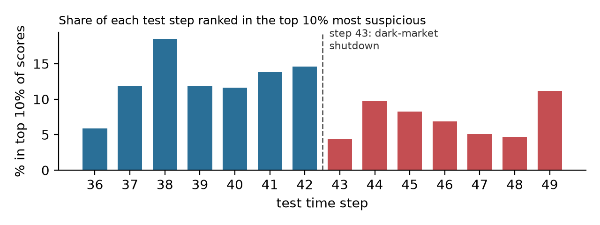

# BT4012 Kaggle Competition: Detecting Illicit Bitcoin Transactions with a Two-Stage Graph Model

**Code:** https://github.com/mfchloe/bt4012 (final model: `e1249331.ipynb`)

---

## 1. Introduction

Bitcoin is pseudonymous: anyone can send funds without revealing who they are. This makes it attractive for money
laundering, ransomware and dark-web markets. Anti-money-laundering (AML) teams must flag suspicious transactions
early, but investigators have limited time, so a useful detector has to rank transactions well: put the illicit
ones at the top without burying analysts in false alarms (in this context, high recall is prioritized over high precision).

In this dataset, each node is a transaction described by 165 anonymised features, and each
edge means an output of one transaction was spent by another. The task is to score transactions from time steps
36–49 using labelled transactions from steps 1–35. Submissions are scored by ROC-AUC,
which measures exactly this ranking quality. Three things make the problem hard:

- **Few labels and heavy imbalance.** Only 22% of training transactions are labelled, and of those only 11.7% are
  illicit.
- **Prediction into the future.** The test steps all come after the training steps, and criminal behaviour changes
  over time. In the original data, models are known to fail after step 43, when a large dark market shut down
  (Weber et al., 2019).
- **Graph structure.** Transactions are not independent; illicit funds move through chains of linked transactions.

I built strong tabular baselines with strict time-ordered validation, then studied the transaction
graph to find information that is consistent between train and test. The final model is a **two-stage LightGBM**:
stage 1 scores every transaction, and stage 2 also uses how suspicious each transaction's neighbours look, trained
with **recency weighting**. It raised my public leaderboard AUC from 0.934 (Random Forest method) to **0.960**.

---

## 2. Methodology

### 2.1 Data preprocessing and feature engineering

The data needed little cleaning: there are no missing feature values, duplicates or self-loops, and the
165 features are already standardised. Tree models need no further scaling. Unlabelled training rows were excluded
from fitting. `time_step` was never used as a model input.

**Key EDA findings that shaped the features.**

1. **Edges never cross time steps,** so no edge links a test transaction to a training label.
2. **The test set is exactly the originally labelled transactions of steps 36–49.** The 31,235 labelled training
   rows plus the 15,329 test rows equal the 46,564 labelled transactions of the original Elliptic data. The 46,668
   transactions that appear only in the edge list are that period's unlabelled transactions; they have no features.
3. **Illicit transactions cluster (homophily).** Among labelled neighbours, 57% of an illicit transaction's
   neighbours are illicit, against 3% for a licit one. Illicit transactions are also more often simple one-in /
   one-out links, consistent with "peeling chains" that pass funds along.

Because of finding 2, every neighbour feature uses **labelled neighbours only**. A test
transaction's unlabelled neighbours have no features, so using them in training would teach the model to rely on
information it does not have at test time. Restricting to labelled neighbours makes each feature mean the same thing
in train and test.

| Feature group    | Description                                                                                                             | Count |
| ---------------- | ----------------------------------------------------------------------------------------------------------------------- | ----- |
| Raw              | The 165 given features                                                                                                  | 165   |
| Structural       | In/out degree on the full edge list, split into labelled vs unlabelled neighbours, and the share of labelled neighbours | 7     |
| Neighbour scores | Mean and max stage-1 illicit score over incoming, outgoing and all labelled neighbours                                  | 6     |

My first attempt averaged neighbours' raw features and did not help,
probably because about 72 of the given features already summarise each transaction's neighbourhood. A stage-1
model's score compresses the 165 features into one number about _illicitness_, which is exactly the clue homophily
suggests. To avoid leakage, training rows receive **out-of-fold** stage-1 scores: the training steps are split into
five blocks of consecutive steps, and each block is scored by a model trained on the other four. Since edges stay
within a step, a transaction and all its neighbours are always scored by a model that saw none of them.

I also tested a feature split into the 93 "local" and 72 "aggregated" features suggested by the original dataset.
The data only partly supported this boundary, so no feature selection was applied.

### 2.2 Model development and validation

Random K-fold would mix time steps and place linked transactions on both sides of a split, which
overstates performance. All validation is therefore **temporal**: fit on steps 1..*t*, validate on steps
*t*+1..35, measuring **pooled** ROC-AUC across all validation steps (as Kaggle does). Pooled AUC also rewards
consistent score levels across steps, not just good ranking within each step.

A single split proved unreliable. Models scored about 0.997 on validation but 0.93–0.95 on the leaderboard. Models
that had not seen step 23 missed a new group of illicit transactions, so I also built a "hard" split (fit 1–22).
Checked against my submissions' leaderboard scores, the hard split ranked them **wrongly**, while splits that
include step 23 ranked them correctly. My final selection rule was:

- **Main check:** mean pooled AUC over four windows (fit 1–24, 1–26, 1–28, 1–30), which agreed with the leaderboard.
- **Sanity check:** mean over fit 1–20 and 1–22; a model may not lose much here.
- **Noise awareness:** changing only the random seed moves a split's AUC by up to about 0.005–0.009, so candidates
  were compared over 3 seeds and multiple windows.

**Final model:** Stage 1 is LightGBM on raw + structural features. Stage 2 is LightGBM on raw + structural +
neighbour-score features (500 trees, learning rate 0.02, 15 leaves, 30% of columns per tree), averaged over 5
seeds, then refit on all labelled rows of steps 1–35.

- **Class imbalance:** `class_weight="balanced"` makes errors on illicit rows count about 8-10× more (the licit:illicit ratio). It barely changed AUC but gave better-balanced precision and recall.
- **Overfitting and drift:** column subsampling (each tree sees 30% of features) stops the model relying on a few
  dominant features that may drift; seed averaging removes the run-to-run noise this adds.
- **Recency weighting:** a row from _k_ steps before the last training step gets weight 0.95^_k_ (step 35: 1.0,
  step 25: 0.60, step 1: 0.17), so recent behaviour is more important than older illicit examples.
- **Tuning:** a small grid over leaves, column share, minimum leaf size, learning rate and decay strength (0.95,
  0.9, 0.85, 0.8). No setting beat the chosen one on both checks.

### 2.3 Model exploration and final strategy

| Stage     | Model / change                                                                                        | Main val. AUC | Public LB            | Outcome                             |
| --------- | ----------------------------------------------------------------------------------------------------- | ------------- | -------------------- | ----------------------------------- |
| Baseline  | Logistic regression                                                                                   | 0.886         | –                    | linear model too weak               |
| Baseline  | Random Forest (balanced)                                                                              | 0.9965        | 0.934                | first submission                    |
| Boosting  | LightGBM, 165 raw (tuned)                                                                             | 0.9971        | 0.948                | beat RF and the rest                |
| Boosting  | XGBoost / CatBoost                                                                                    | 0.995–0.996   | –                    | worse on unseen patterns            |
| Features  | + neighbour mean/max of raw features                                                                  | 0.9972        | –                    | no gain                             |
| Features  | Blend with a feat_94–165-only model                                                                   | 0.991         | 0.920                | won hard split, lost LB             |
| Graph     | + structural + neighbour scores                                                                       | 0.9982        | –                    | gain on main check                  |
| **Final** | **+ recency weighting 0.95**                                                                          | **0.9984**    | **0.960**            | **best on both checks**             |
| Dropped   | 2-hop scores; 2nd round of scores; ExtraTrees / RF blends; post-hoc neighbour smoothing; larger trees | ≤ 0.9985      | 0.957 (larger trees) | each lost on the sanity check or LB |

_Main val. AUC: mean over fit 1–24/26/28/30 for the Graph, Final and Dropped rows; earlier rows were scored on fit 1–24 only._

Trees beat the linear model by a wide margin, and LightGBM beat XGBoost and CatBoost on patterns unseen in training.
Within the graph experiments, recency weighting was the only change that improved both validation checks, and it
recovered the small sanity-check loss of the graph features. I therefore selected this model and confirmed it on the
public leaderboard (0.948 → 0.960). A variant with larger trees tied it on validation but scored 0.957 on the leaderboard, so I kept the
simpler model for the final ranking. Since the public leaderboard uses only 30% of the test data, I did not really want to chase
small public gains that validation did not support.

---

## 3. Results and Discussion

**Validation metrics** (fit steps 1–24, validate on 7,629 labelled rows of steps 25–35, 1,425 illicit; threshold 0.5
for precision/recall/F1):

| Model                           | ROC-AUC    | PR-AUC    | Precision | Recall    | F1        |
| ------------------------------- | ---------- | --------- | --------- | --------- | --------- |
| Logistic regression             | 0.886      | 0.528     | 0.386     | 0.964     | 0.551     |
| Random Forest                   | 0.9965     | 0.988     | **0.983** | 0.906     | 0.943     |
| LightGBM, 165 raw               | 0.9972     | 0.989     | 0.913     | 0.972     | 0.942     |
| **Final two-stage graph model** | **0.9979** | **0.993** | 0.936     | **0.975** | **0.955** |

The final model has the best ROC-AUC, PR-AUC, recall and F1. Random Forest has higher precision but misses about 9%
of illicit transactions. In AML, a missed laundering chain usually costs more than an extra review, so higher recall
at similar precision is the better trade-off. PR-AUC matters here because illicit cases are rare: it rises from
0.989 to 0.993.

**Public leaderboard:** Random Forest 0.934 → LightGBM 0.948 → final model **0.960**.

Most predictive power still comes from the raw features (the top four account for 37% of the gain). The neighbour-score features take about 6% of the gain, with `nb_all_mean` the highest-ranked engineered feature. The structural counts contribute little on their own, which matches earlier experiments where degree alone did not help.

**Limitations**

- **Time drift remains the main weakness.** The figure shows how many transactions in each test step the model places
  in its top 10% most suspicious. This share drops sharply at step 43 and stays lower for most later steps, matching the dark-market shutdown reported for
  the original data. The model has only learnt pre-shutdown behaviour; illicit activity that changed after step 43 is
  likely to be under-detected, and no validation window can measure this because labels end at step 35.
- **A large validation-to-test gap.** Validation AUC (~0.998) is far above the leaderboard (~0.96), so validation
  can only rank models, not predict the test score.
- **A dataset-specific signal.** The labelled-vs-unlabelled neighbour counts partly reflect how the dataset was
  built (which transactions received labels), not just criminal behaviour. They would not carry over to a real
  deployment where new transactions have no labels yet.
- **Small gains.** The improvements on validation (+0.0008 main check) are near seed noise; the leaderboard
  improvement (+0.012) gives more confidence, but on only 30% of the test data.

---

## 4. Conclusion and Reflection

The biggest gains came from **understanding the data**, not from more complex models. Two observations drove the
final model: the test set's construction made labelled-neighbour features consistent between train and test, and
strong homophily made neighbours' predicted suspiciousness a useful clue. Using neighbours' **scores** rather than
their raw features, with out-of-fold scoring to prevent leakage, turned a graph idea that failed earlier into a
gain. Recency weighting then helped the model focus on recent behaviour.

The most important lesson was about **validation**. A near-perfect validation score was misleading, and a "harder"
split chosen by intuition picked the wrong model. Checking each validation scheme against real leaderboard results,
and comparing over several seeds and windows, made model selection much more reliable.

If I had more time, I would like to try graph neural networks or label propagation, since these use the whole
transaction graph instead of only direct neighbours. I also did not make use of the 110,000 unlabelled training
transactions, and a semi-supervised approach might get more out of them. Lastly, the step-43 shutdown made me realise
it would be useful to have some way of detecting drift, so the model can be retrained once criminal behaviour starts
to change. Overall, my biggest takeaway is that fraud detection is not just about getting a high accuracy score.
Criminals keep changing how they operate, so a model that works well on past data can quickly become outdated. In
practice, I think a fraud detection system would need time-aware validation, regular monitoring and retraining to
stay useful.

---

## 5. References

Weber, M., Domeniconi, G., Chen, J., Weidele, D. K. I., Bellei, C., Robinson, T., & Leiserson, C. E.
(2019). _Anti-Money Laundering in Bitcoin: Experimenting with Graph Convolutional Networks for Financial Forensics._
KDD Workshop on Anomaly Detection in Finance.

## AI Tool Declaration

I used **Claude (Anthropic, Claude Opus 5.5 via Claude Code)** throughout this project. Specifically, I used it to:

- **Analyse the data and generate ideas:** exploring the dataset and transaction graph, and suggesting approaches. This included noticing that the test set contains only the originally labelled transactions, and proposing the neighbour-score features and recency weighting used in the final model.
- **Write and run code:** AI assisted me in writing code (including `src/graph2.py`, `src/make_submission.py`, the scripts in `scripts/`, `notebooks/06_graph_model.ipynb` and `e1249331.ipynb`), and running the validation experiments and generating the submission files.
- **Interpret results:** computing the evaluation metrics, feature importances and the figure in this report, and explaining results and concepts to me.
- **Write and format the report and documentation:** Fixing my grammar, tone, and formatting the report.

I led the project throughout: I set the goals, directed which ideas to pursue, and made all submission and model-selection decisions, including keeping the 0.960 model rather than a variant that tied it on validation. I questioned and tested design choices until I understood them, and I revised the report's structure and wording myself. I verified that the submitted notebook reproduces my leaderboard submission. I am responsible for the content and quality of the submitted work.
